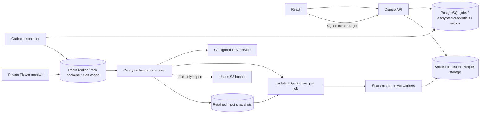

# Rulecraft

Rulecraft is the user-facing name of the PatternForge project (previously Clearflow). The repository, API and existing deployment hostname remain unchanged; dated acceptance records retain their original names. See the [interface design notes](docs/UI_DESIGN.md).

The [2026-10-22 UI refresh](reports/UI_REFRESH.md) is deployed: all three code CI jobs and 28 live HTTPS/gate checks passed; an actual retained AWS snapshot completed a new 1,000-row/800-change browser job after its original one-hour connection naturally expired. Full 24-hour retention observation is still not claimed.

A private, natural-language workspace for transforming CSV and Excel data from **your own Amazon S3 bucket**.

**React · Django REST Framework · Celery · Redis · PostgreSQL · PySpark**

[中文启动说明](docs/START_HERE_zh.md) · [零订阅费用方案](docs/FREE_ONLY_zh.md) · [Architecture](docs/ARCHITECTURE.md) · [Submission checklist](docs/SUBMISSION.md) · [API contract](docs/API.md) · [Security](docs/SECURITY.md)

## What it does

- Connect with user-entered AWS Access Key, Secret Key, optional STS token, bucket and region. No predefined bucket or hard-coded production credentials.
- Browse S3 objects with prefix filtering and continuation-token pagination.
- Inspect CSV and `.xlsx` asynchronously; select an Excel worksheet and preview at most 100 rows.
- Describe a pattern in natural language, select text columns, and replace every non-overlapping match with literal text.
- Use two additional LLM-assisted transformations through the same task/Spark pipeline: **extract a field** into a new column, and **standardize text** with ordered, approved operations.
- Track persistent jobs, recover after refresh, retry transient failures, and cancel actual computation.
- Browse immutable Parquet results using signed cursors without recomputing or collecting the whole dataset.
- Monitor workers with Flower and persisted job metrics. Start the complete stack with Docker Compose.
- Optional **simulated read-only bucket** for testing without AWS credentials (`SAMPLE_BUCKET_ENABLED=1`): synthetic CSV/Excel data, the same genuine model/Celery/Spark pipeline, and explicit sample labels in API/UI. It is not Amazon S3 and is not evidence of real-AWS acceptance. [Sample test guide](docs/SAMPLE_BUCKET_zh.md).

## Honest validation status

The repository contains real provider integrations. It does not invent model output when a model key is missing.

**Real Amazon AWS acceptance completed on 2026-10-21:** 65 end-to-end checks and 23 stability checks passed against the public deployment using two genuine private S3 buckets, user-entered read-only keys, CSV/Excel snapshots and actual model/Celery/Redis/PySpark processing. Both formats passed all three operations; a real 50,000-row S3 file produced 40,000 expected email replacements using two executors/eight partitions (Spark 13.305 seconds). The actual browser also connected, imported and displayed successful results. See [real AWS evidence, raw reports and limitations](reports/REAL_AWS_ACCEPTANCE.md) · [中文测试指南](docs/REAL_AWS_ACCEPTANCE_zh.md). Expiry was accelerated for one app connection; retry used an isolated one-attempt injected fault, not a natural AWS outage. No full 24-hour observation or real-AWS million-row run is claimed.

The optional sample bucket remains as **historical development evidence**, not final AWS acceptance. Its earlier 44 checks and 25 HTTPS/session checks used explicitly synthetic sources; they are not included in the 88 real-service checks above. [Sample evidence](reports/SAMPLE_ACCEPTANCE.md) · [Sample guide](docs/SAMPLE_BUCKET_zh.md). No independent simulated public acceptance was repeated after the final real-AWS requirement was confirmed.

Current cloud host: **Azure for Students**, without a payment method or paid upgrade. The complete x86-64 stack is running at [Rulecraft](https://clearflow-patternforge.australiaeast.cloudapp.azure.com/). The real-AWS acceptance's external HTTPS/password/session checks passed 26 checks. Earlier genuine-model semantics passed 10/10 bounded cases, separate from the subsequent real-AWS jobs. See [Azure acceptance](docs/AZURE_ACCEPTANCE_zh.md). The completed-job demo video and reviewer repository access are still pending/need confirmation. Azure student credit and AWS Free plan allowances are finite, not permanently free hosting.

Custom identifiers need their format in the instruction (for example, a prefix plus digits), because private data rows are never sent to the model. Refused plans stop before Spark and are not cached. The provider uses operation-specific instructions and public few-shot examples; actual uncached requests still invoke the genuine model, never a built-in prompt-to-regex fallback.

Local tests cover API validation, encrypted credentials, session/CSRF isolation, cache behavior, retries, cancellation state, outbox recovery, pagination and real Java/Spark expressions. CSV and Excel inspection are also exercised through the actual isolated Spark driver. Native Windows Parquet output requires Hadoop native binaries; the complete output path is tested in Linux CI/Docker instead of pretending the Windows installation includes them.

The separate `compose.ci.yml` overlay uses **synthetic S3 and LLM protocol fixtures** solely for reproducible integration tests. PostgreSQL, Celery, Redis, the Spark master and two Spark workers remain real. A green fixture test is not proof of real AWS permissions, real model accuracy, or a public deployment.

On commit 2f5efb9a, [application CI](https://github.com/mingyanc74/patternforge/actions/runs/39429269402) passed 75 Linux backend tests, 5 frontend tests, the production frontend build and distributed integration. A separate [genuine Qwen3 container run](https://github.com/mingyanc74/patternforge/actions/runs/39429271689) passed 10/10 bounded semantic cases and the complete 1,000-row task harness using actual model inference. S3 remained synthetic in both workflows; model accuracy outside the recorded cases is not guaranteed.

The [3-million-row, 10-column distributed benchmark](reports/BENCHMARK.md) passed: each of the three operations used two real executors, and Spark processing took 102.6–107.5 seconds per operation. See [validation evidence](reports/VALIDATION.md) for tested commits and limitations.

**Before final assessment submission:** record/embed the real-service demonstration video and confirm reviewers can access the private repository. The public genuine-model stack and documented real-AWS runs now exist; million-row fixture timing remains distinct from the 50,000-row genuine-AWS measurement. Track remaining items in [SUBMISSION.md](docs/SUBMISSION.md); unverified items are not claimed as complete.

## Quick start: complete stack

Prerequisites: Docker with Compose v2 and a Linux container runtime. The complete stack is verified on x86-64 Linux; Java paths and the optional CPU-model image support ARM64, but full ARM runtime acceptance is still pending. Allocate at least 8 GB for development, or a 12 GB-class host for the full CPU-model deployment; measure actual capacity on the chosen host. Docker Desktop on Windows must be running before Compose is invoked.

```bash
python scripts/bootstrap.py
```

This creates a git-ignored `.env` with independently generated application, encryption, database and monitor secrets. It never overwrites an existing file or prints the secrets. Set these server-side values in `.env`:

```dotenv
LLM_BASE_URL=https://api.openai.com/v1
LLM_API_KEY=your-private-service-key
LLM_MODEL=a-structured-output-capable-model-you-can-access
```

Use a provider/model supporting the Chat Completions JSON-schema protocol. An explicitly configured compatible provider with JSON-object mode can set `LLM_JSON_SCHEMA=0`; server-side validation still applies. No automatic fallback to weaker modes occurs.

For **no model-service subscription**, download the official checksum-pinned CPU weights and use the optional local-model overlay instead. It performs genuine model inference, not the deterministic CI fixture:

```bash
python scripts/free_model.py --download-only
docker compose -f docker-compose.yml -f compose.local-model.yml up --build
```

The model stays on the internal container network. See [free-only instructions and public-hosting limitations](docs/FREE_ONLY_zh.md). Otherwise, use the regular command below with your configured provider.

```bash
docker compose up --build
```

Open **http://localhost:8080**. Flower is bound to **http://localhost:5555** with credentials from the private `FLOWER_BASIC_AUTH` setting. Database, Redis, Spark and worker ports are not published.

Enter **your AWS credentials in the application**, not in repository files. The bucket needs list access and selected objects need read access. The platform never requires write permission to your input bucket. Supporting region discovery may require permission to inspect bucket location. A denied or ambiguous AWS response is surfaced safely rather than misdiagnosed.

Normal shutdown preserves database and result volumes:

```bash
docker compose down
```

Do not add `-v` unless you explicitly intend to remove local persisted data.

## VS Code / native UI development

Open the repository folder in VS Code. Provided tasks cover bootstrap, full-stack Docker, local backend, frontend build and tests.

```bash
python -m venv .venv
# Activate .venv using your platform's normal activation command.
python -m pip install -r backend/requirements-dev.txt
python scripts/bootstrap.py
python scripts/local_backend.py
```

In another terminal:

```bash
cd frontend
npm ci
npm run dev
```

Open **http://127.0.0.1:5173**. Vite proxies `/api` to `127.0.0.1:8000`. The local backend uses SQLite and local storage for UI/API development. It deliberately reports missing queue/model configuration. **A standalone frontend and development server do not replace the complete Celery/Redis/Spark stack.** Use Compose for full end-to-end processing.

Native Windows Spark tests use Java 17 and a direct Java launcher to avoid command-shell encoding corruption in Chinese paths. Linux containers remain the supported complete processing environment.

## User workflow

1. Connect your S3 bucket, using an STS session token when applicable.
2. Select a CSV or Excel file. For Excel, select the required worksheet.
3. Inspect it, confirm the preview, and choose target columns.
4. Select **Find & replace**, **Extract a field**, or **Clean & standardize** and enter an instruction.
5. Submit. The API returns HTTP 202 and a persistent Job ID immediately; heavy work stays in Celery/Spark.
6. Follow stages, return through Activity or the task URL, or cancel the job.
7. Read the completed result in pages. The original S3 object is never overwritten.

Replacement is literal: `$1` is inserted as `$1`, not interpreted as a capture group. Empty replacement deletes matches. Null stays null. No matches is a successful job with zero changed cells, not an empty result set. Extraction uses the first match and returns null when no value is found.

## Format and operation boundaries

| Area | Behavior |
|---|---|
| CSV | Header required; UTF-8, UTF-16, ISO-8859-1; comma, semicolon, tab or pipe; quoted commas and multiline fields supported |
| Types | Values are ingested as strings to preserve IDs and leading zeroes; Excel dates become ISO text |
| Null | CSV `\N` is the documented null marker; quoted empty text is distinct where the parser supports it |
| Excel | `.xlsx`, worksheets selectable, streaming conversion to a staged CSV followed by a Spark DataFrame; `.xls`, encrypted workbooks and formula evaluation are unsupported |
| Headers | 1–200 nonempty, case-insensitively unique names; max 255 characters |
| Default limits | CSV 2 GB; Excel 100 MB; cells 65,536 characters; preview row 128 KiB of serialized characters; tunable via configuration |
| Normalization | Ordered trim, collapse whitespace, lowercase, uppercase; arbitrary semantic rewriting is rejected |
| Regex | Conservative Java/Python-compatible subset; no lookaround, backreferences, nested repetition, repeated alternatives, unbounded wildcard repeats or zero-length matches |
| Pagination | Default 100, max 500 rows; JSON page bounded to approximately 2 MiB, so wide rows can yield fewer rows with a valid next cursor |
| Retention | Connections default to 1 hour; imported datasets and results to 24 hours. Expiry/disconnect prevents new imports, not processing an available imported dataset |

LLM plans are schema-validated; no generated Python, SQL, shell commands or arbitrary functions are evaluated. Only the prompt, chosen operation and necessary column names are sent to the model. Raw data rows and AWS credentials are never included in model requests.

## Architecture



- The HTTP process never parses a full file, generates a regex or performs replacement.
- PostgreSQL is authoritative for job status; Redis Celery results are not the only durable job record.
- The transactional outbox prevents accepted HTTP 202 jobs from being lost between database commit and broker publication. A dispatcher outside the task queue also resumes publication after Redis returns.
- Each job has a lease and attempt-specific workspace. Duplicate deliveries cannot overwrite terminal states. Only a complete manifest becomes visible.
- New imports use AWS credentials only in orchestration; subsequent Spark jobs read retained snapshots without AWS credentials. The legacy S3A path retains an isolated credential context. Plaintext keys are never passed in command-line arguments or Celery messages.

Website access, browser ownership and S3 authorization are separate mechanisms. See [dataset retention and password access](docs/DATASETS_AND_ACCESS_zh.md).
- The worker polls cancellation while its child runs. An independent driver lease guard also stops work after parent loss, cancellation, lease replacement or a hard deadline.
- Parquet is split into bounded files and indexed by row-group metadata. The API reads the relevant batches through PyArrow rather than starting Spark for every page.
- The provided deployment uses a named shared volume, appropriate for a single-host multi-container assessment. A multi-host deployment must replace it with a shared filesystem or object-store-aware result service; mounting unrelated local directories on different hosts is not supported.

### Partitioning and scale

CSV parsing enables multiline support, which may make a single source object unsplittable during parsing. After ingestion the DataFrame is explicitly repartitioned (`SPARK_PARTITIONS`, default 8), and replacements/extraction/normalization use Spark expressions across those partitions. This is an intentional correctness/performance trade-off; bulk production workloads should prefer partitioned CSV/Parquet inputs or a separate single-line CSV mode.

Input caching uses `DISK_ONLY` to avoid retaining a large dataset in driver memory. Statistics and output remain distributed. At most 100 bounded preview rows are collected. A result file holds at most 1,000 records; the API indexes its row groups and batches page reads. Output ordering is stable within a manifest version, not guaranteed to preserve original input order.

Two Spark workers each advertise one core and 2 GB by default; executor memory is 1 GB and the application is capped at two cores. Increase resources and partitions together for the benchmark; do not interpret a higher partition count alone as more physical compute. The README and actual report must state the tested settings.

## Tests and continuous integration

```bash
python -m pip install -r backend/requirements-dev.txt -r backend/requirements-spark.txt
python -m ruff check backend scripts
python -m pytest -q
cd frontend
npm ci
npm run build
npm test
```

Java 17 is needed for Java validation and Spark tests. Use `pytest -m "not spark"` for the remaining backend tests. The Java validator test still requires Java. Test credentials and response fixtures are deliberately invalid for real services.

CI contains three independent jobs: backend/real Spark tests, frontend checks, and a **real distributed Docker stack** tested through HTTP against the explicitly synthetic provider fixtures:

```bash
python scripts/bootstrap.py
docker compose -f docker-compose.yml -f compose.ci.yml up -d --build --wait
python scripts/smoke_e2e.py --rows 1000
```

The smoke test covers dynamic bucket setup, CSV, multi-sheet Excel, all three transformations, multiple partitions, result pages, session isolation and a cancellation request. Provider fixtures do not prove model semantics or AWS authentication correctness; those have a separate real-service checklist.

For a large test, manually run the **Verify application** workflow with `benchmark_rows=3000000` or use:

```bash
python scripts/smoke_e2e.py --rows 3000000 --report reports/local/three-million-rows.json
```

This generates ten columns and exercises actual S3-protocol input and three distributed transformations with deterministic provider fixtures. It asserts two active executors, exact row/changed-cell counts, result pagination, Excel transformation, cache reuse and actual running Spark cancellation. Record environment resources, rows, actual bytes, partitions, timings, correctness and limitations. Do not label fixture timing as a real-AWS/real-LLM measurement.

Generate ten-column files for the real acceptance run:

```bash
python scripts/generate_dataset.py --rows 3000000 --output data/fixtures/customers.csv
python scripts/generate_dataset.py --rows 100 --output data/fixtures/customers.xlsx
```

Upload only to a bucket you intentionally choose, then process it through the normal UI. The generator does not upload automatically or require access to any existing private file.

## Production deployment

Selected delivery mode: **independent cloud host, free resources only**. No laptop tunnel or static-only deployment is substituted. The complete stack is deployed on the user-approved Azure student-credit VM; the repository does not automatically provision additional cloud resources. Follow the [independent-cloud checklist](docs/CLOUD_DEPLOY_zh.md) for reproducible deployment and remaining real-S3 acceptance.

For the internal free CPU model on that host, set the real DNS hostname in the private environment file, then run:

    python3 scripts/free_model.py --download-only
    python3 scripts/cloud_preflight.py
    docker compose -f docker-compose.yml -f compose.local-model.yml -f compose.production.yml up -d --build --wait --wait-timeout 600

The default Caddy configuration requires a DNS hostname for trusted HTTPS, not a bare IP. The following alternative is for an externally configured genuine model:

Use a Docker-capable Linux host with sufficient memory, a hostname pointed to it, and inbound ports 80/443. Set `DOMAIN` in the server's private `.env`, configure a real model, and run:

```bash
docker compose -f docker-compose.yml -f compose.production.yml up -d --build
```

Caddy terminates HTTPS; secure cookies, trusted origins and HTTPS redirects are enabled for the web API. Only the gateway is public; monitor access remains loopback-only. Back up PostgreSQL and the result volume; protect the encryption key independently. See [SECURITY.md](docs/SECURITY.md) before making a deployment public.

## Demo video and public URL

**Public URL:** https://clearflow-patternforge.australiaeast.cloudapp.azure.com/ — external HTTPS, password gate, real S3 CSV/Excel jobs, genuine model, queue, distributed Spark and results verified on 2026-10-21. [Actual AWS report](reports/REAL_AWS_ACCEPTANCE.md). Access password and read-only AWS keys are provided privately, never in this repository.

**Demo video:** not recorded yet. Use the exact recording checklist in [SUBMISSION.md](docs/SUBMISSION.md), then replace these lines with the verified URL and an embedded video link/player. A UI-only recording does not meet the required real S3 plus completed asynchronous job demonstration.

## Troubleshooting

| Symptom | Next step |
|---|---|
| Service setup required | Check Docker is running; inspect `docker compose ps`; configure the real model |
| Job stays queued | Check dispatcher, Redis, Celery worker and queued outbox metrics; restarting only the browser cannot fix a stopped worker |
| AWS connection fails | Check key, session token, region, bucket name, list/read permissions and key expiry |
| Source changed | Reinspect the object; jobs are bound to its recorded fingerprint |
| Unsupported / unsafe regex | Use a more specific description within the documented subset; do not disable validation |
| Excel requires a sheet | Select a worksheet and inspect it before submitting a transformation |
| Result expired | Submit a new job; expiry does not modify the original S3 file |
| Native Windows Parquet fails | Use the supplied Linux Docker environment; do not download unknown Hadoop DLLs just to suppress the failure |

## Primary technical references

- [Spark 3.5.8 documentation](https://spark.apache.org/docs/3.5.8/)
- [Celery with Django and transaction boundaries](https://docs.celeryq.dev/en/stable/django/first-steps-with-django.html)
- [Django deployment checklist](https://docs.djangoproject.com/en/5.2/howto/deployment/checklist/)
- [OpenAI structured output protocol](https://developers.openai.com/api/docs/guides/structured-outputs?api-mode=chat)
